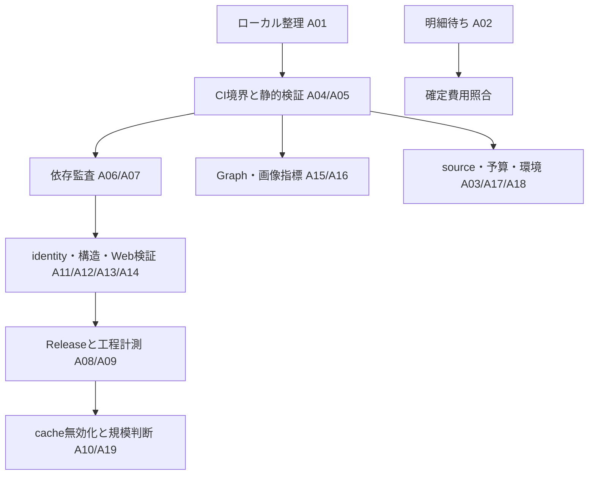

> 完了済み監査の履歴（2026-10-21）。現在のタスクは[次の作業](../../next-work.md)。以下は当時の判定と証拠で、再実行指示ではありません。

# リポジトリ整理・残課題監査

2026-10-16 JST。基点は main `abaef1fcbd4421ea6d55776921961e7b6a1932d5`。
これは整理時点の監査基点である。後続の「20項目を継続して進める」というユーザー指示に基づく進捗を末尾で管理する。

## 調査範囲と制約

GitHub上の追跡ファイル257件を取得して横断検索・静的確認した。内訳はDocs81件、Python本体57件、tests72件、scripts8件、Web24件、Actions5件、その他10件。
Web lockの571 packageも構造を確認した。TODO検索だけでなく、収集/課金/保存/公開の境界、テスト対象選択、現行文書と過去記録の食い違いを確認した。
GitHubの全Open Issue/PR、最近のIssue/PR100件と次ページ、Actions直近30 run、最新日次4 jobの結果、最新collectログ、remote branch12本を確認した。

前回はローカルshell/Nodeが起動できず、remoteの追跡ファイルだけを監査した。
後続作業ではローカル実行が復旧し、mainの基点一致・未commit変更なし・適用AGENTSなしを確認した。旧実施記録4ディレクトリ/69ファイルはSHA-256一致を確認してprivateな `local-state/archive/2026-10-16/` へ集約した。空の一時Vaultも削除し、使用中のvenv/npm/engineと生成cacheは開発環境として区別した。
「リポジトリ全体」は上記remote基点の追跡ファイルを指す。初回の静的監査ではpytest/npm audit/actionlintの新規実行・GCSの独立照合は未実施だった。後続の実行結果は末尾で更新する。静的な改善候補を再現済み不具合として扱わない。

## 監査基点で確認した値

- Open Issueは[#116 請求照合](https://github.com/Ningensei848/kaname/issues/116)のみ。整理前のOpen PRは0件。
- [main Checks](https://github.com/Ningensei848/kaname/actions/runs/38736067455)はsuccess。
- [10月16日日次](https://github.com/Ningensei848/kaname/actions/runs/38829280508)はcollect/publish/Pages build/deployがsuccess。09:24:13〜09:36:45 JST、752秒。30生成の通常runで、過去の生成0・422秒との同条件比較ではない。
- collectログは30呼出し/30 HTTP試行/30保存、usage欠損0、成功行528、保留60、公開export246件。保留80→60は新規発見も含む差分であり、単純な30減ではない。
- 今回のsource完了はCloudflareのみ。DeepMind6件/Meta4件/Cloudflare20件を保存。他sourceは完了と判定しない。
- 10月16日のusage推計USD 0.0819758、10月合計USD 1.62600285、uncertain/incomplete/未決済Batchは0、legacy model仮定9件。確定請求とは異なる。
- 以前の追加USD 1台帳は10月15日時点で累積0.4460520。10月16日分も同じ台帳へ含める保守的な計算では累積0.5280278、残額0.4719722。ただしこの計算は承認範囲の延長や本番state更新ではない。

## 残課題・改善候補

以下は監査基点の20項目であり、現在の完了/未完了は末尾の進捗表を参照する。P1は次の開発再開時に先に扱う事項、P2は計測/必要条件を満たして着手する事項、P3は将来判断である。セキュリティ緊急度やIssueの新規登録を意味しない。

| ID / 優先 | 課題・根拠 | 次の一手と完了条件 |
|---|---|---|
| A01 / P1・環境待ち | ローカルの未追跡・ignored一時物は未確認。今回のremote整理だけではローカルcache/メモの削除完了とできない | 実行環境復旧後に `git status --short --untracked-files=all`、`git status --ignored --short` と適用AGENTSを確認。未commitの成果を保全し、cacheと未完了メモを区別して整理 |
| A02 / P1・明細待ち | #116は未完了。7 source化後も旧2 sourceの月500〜550円推定を使い続けられない。元usageは明細を代替しない | 確定期間/通貨/時間帯/調整項目を揃え、元価格・Batch課金ID・unknown/legacy9件・GCS/Actions対象外を区別。差額と未照合範囲を記録 |
| A03 / P1・継続運用 | 保留60件。日次successと全source healthyは異なる。完了判定とstreakの規則は [src/techkb/source_health.py:58](https://github.com/Ningensei848/kaname/blob/abaef1fcbd4421ea6d55776921961e7b6a1932d5/src/techkb/source_health.py#L58) | 通常運用の読取りsource-healthでsource別pending/last success/streakを確認。既定30件を勝手に拡大せず、各sourceの完了後に復旧を判定 |
| A04 / P1・静的確認 | CI対象選択にWeb入力境界の抜けがある。`web/kaname_web/public_input.py`は`release_bundle.release_input`を使うが、`src/techkb/release_bundle.py`単独変更はPython full・Web falseとなる。[scripts/check_scope.py:27](https://github.com/Ningensei848/kaname/blob/abaef1fcbd4421ea6d55776921961e7b6a1932d5/scripts/check_scope.py#L27)、[web/kaname_web/public_input.py:3](https://github.com/Ningensei848/kaname/blob/abaef1fcbd4421ea6d55776921961e7b6a1932d5/web/kaname_web/public_input.py#L3) | release bundle/publication、該当テストを含む依存境界でclassifyをレビュー。Git/Release入力契約の変更で実Webチェックも選ばれることを確認 |
| A05 / P1・静的確認 | Docsのリンクやworkflow静的検証が継続CIにない。DocsのみではPython/Webをskipし、Checksにはlink checker/actionlint工程がない。[.github/workflows/checks.yml:25](https://github.com/Ningensei848/kaname/blob/abaef1fcbd4421ea6d55776921961e7b6a1932d5/.github/workflows/checks.yml#L25) | Markdownの相対path/見出し参照とworkflow構文を軽量CIへ。削除/rename、archive URL、未知pathの扱いを確認。今回の手動検査だけで恒久保証としない |
| A06 / P1・既知制約 | npm監査はbracesとsprintf-jsの既知advisoryを許容。今回の最新advisory再取得は未実施。[固定依存の条件](../../web-preview.md#固定依存と残る制約) | 次の依存保守時に公式advisoryと実lockを再監査し、修正可能ならbuild/全Web受入。未修正なら到達条件と許容範囲を更新。警告0とはしない |
| A07 / P2・静的確認 | braces側の監査例外はadvisory URLだけを照合し、sprintf-js側のようなversion/node配置固定がない。[web/audit.mjs:12](https://github.com/Ningensei848/kaname/blob/abaef1fcbd4421ea6d55776921961e7b6a1932d5/web/audit.mjs#L12) | 例外のversion/配置/伝播条件を固定するか、依存経路変更時の別検査を設ける。未審査version・新経路を拒否できること |
| A08 / P2・要計測 | Release作成では基底復元後、draft全chain検証、公開後全chain検証が繰り返される。[src/techkb/release_publication.py:189](https://github.com/Ningensei848/kaname/blob/abaef1fcbd4421ea6d55776921961e7b6a1932d5/src/techkb/release_publication.py#L189)。最新日次のRelease工程は70秒 | HTTP回数/転送bytesを計測。同一実行内の検証済みasset bytes再利用を検討し、fresh metadata/ID/tag/digest・公開前後照合は維持。改変拒否と同条件runで評価 |
| A09 / P2・要計測 | 全体時間はrunner/queue/Web準備/配信待ちでも変動。最新pages build232秒（準備58・復元24・build検証145）、deploy39秒 | 同一Note/生成数/lockで複数回計測し中央値と変動を比較。生成0改善と30生成runを混同しない。全リンク/画像/4幅を省略しない |
| A10 / P3・設計判断 | run間private cache、Web環境/artifact再利用、差分HTML buildは未採用。現在のcacheは同一runner内のbytesだけ。[src/techkb/read_snapshot.py:40](https://github.com/Ningensei848/kaname/blob/abaef1fcbd4421ea6d55776921961e7b6a1932d5/src/techkb/read_snapshot.py#L40) | Note/renderer/config/lock/tag/search/rollback・世代/CRC/catalogの無効化条件とprivate境界を先に定義。必要性と計測結果が出るまでは全件監査/全体buildを維持 |
| A11 / P2・構造改善 | `Pipeline.run`は発見/復旧/予算/standard/Batch/保存/終了処理を一つに保持。[src/techkb/pipeline.py:40](https://github.com/Ningensei848/kaname/blob/abaef1fcbd4421ea6d55776921961e7b6a1932d5/src/techkb/pipeline.py#L40)。Batchも393行で診断/提出/照合/決済が混在 | 純粋な候補判定・状態遷移から小さく分離。durability障害時停止、usage journal、receipt、入力順と単一writerの契約を回帰で保持。機械的な分割を目的にしない |
| A12 / P2・構造改善 | Note identityのsource/canonical URL/hash構築がsnapshot生成・読込み・画像補完に重複。[src/techkb/image_refresh.py:99](https://github.com/Ningensei848/kaname/blob/abaef1fcbd4421ea6d55776921961e7b6a1932d5/src/techkb/image_refresh.py#L99)、[src/techkb/publication/snapshot.py:114](https://github.com/Ningensei848/kaname/blob/abaef1fcbd4421ea6d55776921961e7b6a1932d5/src/techkb/publication/snapshot.py#L114) | bytes互換の純粋helperへ集約する価値を評価。旧Note ID、JSON符号化、tracking正規化、manifest/dataset digestが不変であること |
| A13 / P2・構造改善 | fixture/実Pages検証のserver起動、通信guard、ブラウザエラー処理、リンク走査が重複。[web/check_preview.py:18](https://github.com/Ningensei848/kaname/blob/abaef1fcbd4421ea6d55776921961e7b6a1932d5/web/check_preview.py#L18)、[web/check_pages.py:20](https://github.com/Ningensei848/kaname/blob/abaef1fcbd4421ea6d55776921961e7b6a1932d5/web/check_pages.py#L20) | 同じ契約部分だけ共通化。fixture専用拒否/実版provenance、同時browser最大2、全画像/アンカー/4幅と例外時cleanupを保持 |
| A14 / P2・条件付き | 完了済みGlucoFM画像補完planがconfigに残る。[tests/test_daily_image_repair.py:9](https://github.com/Ningensei848/kaname/blob/abaef1fcbd4421ea6d55776921961e7b6a1932d5/tests/test_daily_image_repair.py#L9)の成功テストがその実在に依存 | fixtureを一時configへ配置して検査する形へ分離した後、計画をarchiveへ退避。現時点は能動的な回帰入力のため保持。plan削除だけでテストを壊さない |
| A15 / P2・評価更新 | Graph品質の基点は125 Note/612検索語・内部辺0。[評価](../../graph-quality.md)。現在246件の結果を示さず、正規化は未適用 | 固定した現公開版を読取り評価し、未解決/曖昧/辺数を更新。検索fallbackの完了とgraph品質を分け、辞書/保存bytesの変更は別判断 |
| A16 / P2・可観測性 | 画像候補があるのにLLMが0選択した成功結果の集約指標がない。[src/techkb/reporting.py:14](https://github.com/Ningensei848/kaname/blob/abaef1fcbd4421ea6d55776921961e7b6a1932d5/src/techkb/reporting.py#L14)、[src/techkb/images.py:95](https://github.com/Ningensei848/kaname/blob/abaef1fcbd4421ea6d55776921961e7b6a1932d5/src/techkb/images.py#L95) | 原文/画像bytesを記録せず候補数/選択数/打切りの匿名集計を検討。0選択を機械的な失敗や再生成条件にせず、品質サンプルで判断 |
| A17 / P2・対象待ち | browser source実運用と利用者Vault/NTFSの受入は未完了。合成Chromium/一時Vaultの検証は存在 | 対象source/Vaultと操作範囲を指定した時だけ環境受入。既存編集/非対応hard link/symlink/robots/redirectの契約を保持 |
| A18 / P3・運用判断 | standardのrun単位推計capは実装済みだが、scheduleは`max_cost_usd:null`。日/月予算は通知、複数runの総枠は自動強制しない。[src/techkb/budget.py:5](https://github.com/Ningensei848/kaname/blob/abaef1fcbd4421ea6d55776921961e7b6a1932d5/src/techkb/budget.py#L5) | 総枠自動停止が必要なら期間・価格・unknown usage・retry・Batchの規則を決める。既定の30件・予算通知を変更する前に要件を確定 |
| A19 / P3・規模待ち | snapshotは全対象bytesをmemoryへ載せ、Stateは月次TSVを読み全行保持。[src/techkb/read_snapshot.py:121](https://github.com/Ningensei848/kaname/blob/abaef1fcbd4421ea6d55776921961e7b6a1932d5/src/techkb/read_snapshot.py#L121)、[src/techkb/state.py:39](https://github.com/Ningensei848/kaname/blob/abaef1fcbd4421ea6d55776921961e7b6a1932d5/src/techkb/state.py#L39) | objects/bytes/RSS/読み書き時間を継続測定。必要になるまでDB移行をしない。index分割やstream化も全件整合性と公開前再照合を条件に検討 |
| A20 / P2・履歴整理 | remoteにはmain祖先の旧作業branch7本と独自commitのある2本が残る。下表 | merged branchの削除は後続のref整理として扱う。独自commit2本は成果を確認するまで保持。main/content/legacyと今回のarchiveは保持 |

source利用条件の未確定範囲は[source方針](../../source-policy.md)と保存した有効化記録に残す。今回の整理は許諾や規約の再評価ではない。
旧レビューのF1〜F7、T0/R1〜R5/O1/O2、Batch成功受入、画像入りNote、NS1、追加4社有効化、GCS16並列/CI再利用は完了証拠があるため、残課題に戻さない。
raw保存の既定無効、外部画像の内容/存続がGitで固定できないこと、new_onlyで既知URLの変更を自動検知しないことは現行仕様である。

## remote branchの判定

基点mainとのcommit祖先比較による。名前だけで達成済みとは判定しない。

| branch | ahead / behind | 扱い |
|---|---:|---|
| `codex/add-test-local-helper-to-contracts.test.ts` | 1 / 258 | 独自commitあり・保持 |
| `codex/domain-publication-web-refactor` | 0 / 108 | mainに到達済み・整理候補 |
| `codex/domain-refactor-production-acceptance` | 0 / 106 | mainに到達済み・整理候補 |
| `codex/f001-r3` | 1 / 270 | 独自commitあり・保持 |
| `codex/glucofm-image-acceptance` | 0 / 98 | mainに到達済み・整理候補 |
| `codex/google-research-body-extraction` | 0 / 104 | mainに到達済み・整理候補 |
| `codex/image-candidate-text-matching` | 0 / 102 | mainに到達済み・整理候補 |
| `codex/implement-common-json-schema-validator` | 0 / 275 | mainに到達済み・整理候補 |
| `codex/repair-note-images` | 0 / 101 | mainに到達済み・整理候補 |

独自commitの対象は旧TypeScriptの `tests/contracts.test.ts` と `.spec/features/001-crawler-idempotency/spec.md`。
今のPython系統へ未取込と断定して削除せず、legacyとの関係を確認する。

## 整理の結果と復元

この節はPR #193の整理時点の状態。後続のコード変更は次節で区別する。

整理前の全257ファイルは元blobを維持して保全した。現在は保全tag `archive/pre-housekeeping-2026-10-16` から参照できる。
整理差分は `codex/repository-housekeeping-2026-10-16`。mainへは自動mergeしない。
過去の証拠50件と、完了済み計画/作業記録11件を整理branchの現行ツリーから外す。
履歴の本文/元blobは書き換えず、[archive索引](../README.md)から復元できる。

現行文書の重複した進捗表を整理し、残課題は[次の作業](completed-work-2026-10-21.md)、保証は[検証基準](../../verification.md)へ集約する。
仕様/操作、ADR、合成corpus、互換entrypoint、現役の画像補完plan、コード/設定/lock/workflow/test本体は保持する。
新しい日次runごとの報告をmainへ追加せず、必要な状態変更だけを反映し、過去の証拠は保全tagへ保管する。

## 改善の依存関係と進捗

2026-10-16の継続指示に基づき、次の順に進める。完了は根拠と検証を伴うものだけを記載する。

基点の全Python786件は成功。最初の差分はA04/A05/A06/A07/A14で、Web依存境界の回帰、文書の削除/改名/見出し/履歴Git参照、必須CI gate、監査のversion/配置/経路、画像補完計画の一時config配置を検証する。

| 項目 | 状態と根拠 |
|---|---|
| A01 | 完了。private旧記録4ディレクトリ69ファイルをhash一致で集約。生成cache/buildの51 path・33,232ファイル（見掛け613,769,903 bytes）を削除。検証後のcacheも追加10 path/225ファイル除去。実行環境と現在のWeb出力2版・有効last-build pointerは保持 |
| A02 | 既存資料による照合判断完了（10/21のユーザー指示）。提供された9月/10月account activities CSVの取引残高は両方整合。前払い/税/利用料を分離し、UTC usage・元価格/legacy9件・Batch IDと照合した。JPY→USD換算レート・project/service/SKU・請求timezoneがなく、usageとの完全一致や差額は未確定と判定。原文/支払識別子/照合表はprivateに保持。追加資料待ちにはせず、完全照合未達の制約を#116へ追記してOpenを維持 |
| A03 | 完了。保留60→27→1を進め、Apple Featured本文selectorを本番適用。[10/21復旧run](https://github.com/Ningensei848/kaname/actions/runs/39604474178)で1呼出し/1試行/1保存、Appleのstreak6→0、311公開Noteの配信照合まで成功。追加推計USD0.0034714。[続くrun](https://github.com/Ningensei848/kaname/actions/runs/39606366786)は新規発見3件を既存規則の許可domain外として無課金で判定し、保留0・有効7 sourceすべてhealthy/streak0。状態593成功行、state/run監査整合、unknown/未計上Batch0。既存追加枠の保守的残額USD0.2980108。関連失敗通知#195〜#201は解決済み |
| A04/A05 | 完了。Web入力契約の対象選択を追加。文書path/見出し/旧Git版参照とchecksum固定actionlintを常時CI化し、Daily再利用にも必須化。[初回CI全gate成功](https://github.com/Ningensei848/kaname/actions/runs/38891217687) |
| A06/A07 | 再監査・例外限定は完了。braces3.0.3/sprintf-js1.1.3にも修正なし。固定lockの9 package・node位置・伝播辺まで許容を限定。Node5件と実npm auditを照合。既知2 advisoryは継続制約 |
| A08 | 完了。同一操作内だけ検証済みasset bytesをbounded LRUへ保持。fresh metadata/tag/全chain検証は維持。改変/欠損/上限/操作跨ぎを含む42件成功。実246記事の読取り比較でmetadata30回不変、転送2,354,862→784,954 bytes。実日次速度の保証とはしない（[配布仕様](../../release-distribution.md#同一処理内のasset-bytes再利用)） |
| A09 | 評価完了。同一246記事・lockのbuild/全受入を前後各3回計測。全生成物digest/検査件数一致、中央値191.344→188.190秒・範囲重複。速度改善は未立証（[計測条件](../../design-decisions.md#固定web入力の反復計測)） |
| A10 | 設計評価完了。private run間cache/環境全体/差分HTMLは無効化条件と境界を定義し未採用。全件監査/全体buildを維持（[採否](../../design-decisions.md#cacheの採否と無効化条件)） |
| A11 | 完了。候補既知判定/完了/障害停止を純粋helperへ分離、receipt復旧を独立methodへ、Batch診断をwriterから分離。保存障害/usage/receipt/入力順の既存回帰を保持 |
| A12 | 完了。identity生成を純粋helperへ統一。実公開246件の元ID・全非Gitファイルhash/dataset不変、関連130件成功 |
| A13 | 完了。server/browser通信guard/リンク検査を共通化。異常時cleanupとeditable installなしのCLI起動回帰を追加。Web11件成功、固定実版の全受入6回で全画像/アンカー/4幅・最大2browserを維持 |
| A14 | 完了。planを `tests/fixtures/image-repair-plan.json` へ移し、一時configでworkflow入口を検証。実configから除去し、保全tagに元pathを保持。関連36件成功 |
| A15 | 評価完了。同じ公開246件を2回読取り評価。tags2,094/keywords1,184、未解決1,184/曖昧0/内部辺0、提案適用後の辺も0。正規化/元Note書換えは未適用（[Graph評価](../../graph-quality.md)） |
| A16 | 完了。候補数/選択数/候補あり0選択/打切りを成功composeで匿名集計。Batchは保存outcomeから固定billing reportへ計上し二重計上しない。旧outcomeの欠損指標は推定補完しない |
| A17 | 完了。ユーザー指定の「現在のsourceと一時領域」で10/21に再受入。有効7 source全件の見出し/本文/HTTP200を照合し、GitHubは一時browser overrideも成功。LLM/GCS書込み0、source設定変更0。Linuxと実Windows Python3.12.14・一時NTFSで編集/候補保持・排他公開・非対応hard link失敗・junction拒否を確認。実Vaultは今回の指定範囲に含めない。`scripts/verify_sync_filesystem.py`で再現可能 |
| A18 | 任意機能の完了。UTC日/月残額・元価格・unknown/未計上Batch停止・run capとの最小値を定義し、複数run/月境界を回帰検証。既定null、本番通知/30件を変更しない（[運用](../../operations.md#任意のutc日月生成上限)） |
| A19 | 評価/計測指標追加は完了。実GCS1,059 object/6,718,993 bytes、index2/305,512 bytes・0.005秒、専用auditプロセス最大RSS85,628KiB。DB移行を先行せず継続観測（[規模判断](../../design-decisions.md#現規模と移行判断)） |
| A20 | 完了。main祖先remote7本とmerge済み整理/改善PRの2 branchを整理、Closed/未マージremote2本とローカル草稿2本を同じarchiveの親commitに保全。mergedローカル38本/保全済み別名2本、stale tracking77本を整理。[保全先](../README.md#closedの旧typescript提案) |

後続の変更は[Draft PR #194](https://github.com/Ningensei848/kaname/pull/194)にまとめ、整理[Draft PR #193](https://github.com/Ningensei848/kaname/pull/193)をbaseとする。10/21の明示承認で順にmainへmerge済み（`351202f` / `8b861a1`）。Apple selectorを含む[6 gate CI](https://github.com/Ningensei848/kaname/actions/runs/38897433859)も成功。mainへのmerge後は独立した本番runで再受入する。

2026-10-21のユーザー指定により、A02は既存資料で照合できる範囲と未確定部分の判断、A17は現在のsourceと一時領域を受入範囲とした。完全な請求一致や実Vault一般への保証へ拡張しない。最終の状態・環境証拠は[archive索引](../README.md#整理後の計測証拠)に保存する。

2026-10-21の追加整理では、保全用2ブランチも同じ先端commitの注釈付きtagへ移し、常設ブランチを `main`・`legacy`・`content` に集約した。旧資料と未マージ草稿の全履歴は[archive索引](../README.md#ブランチを3本へ集約2026-10-21)から参照・復元できる。公開済みtagは保持する。
